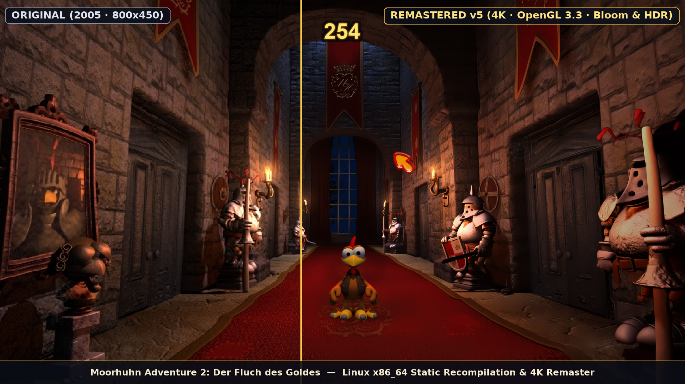
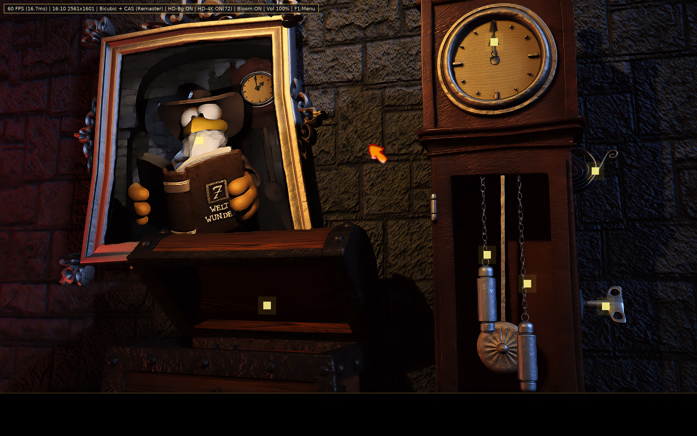
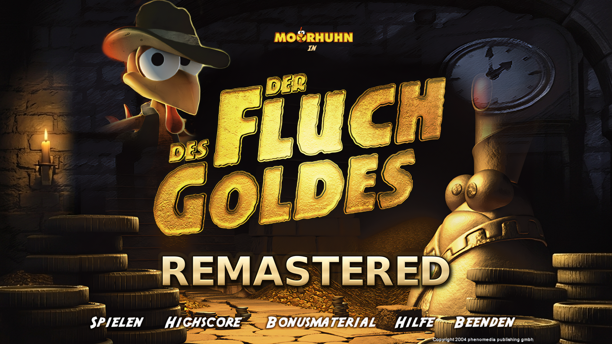
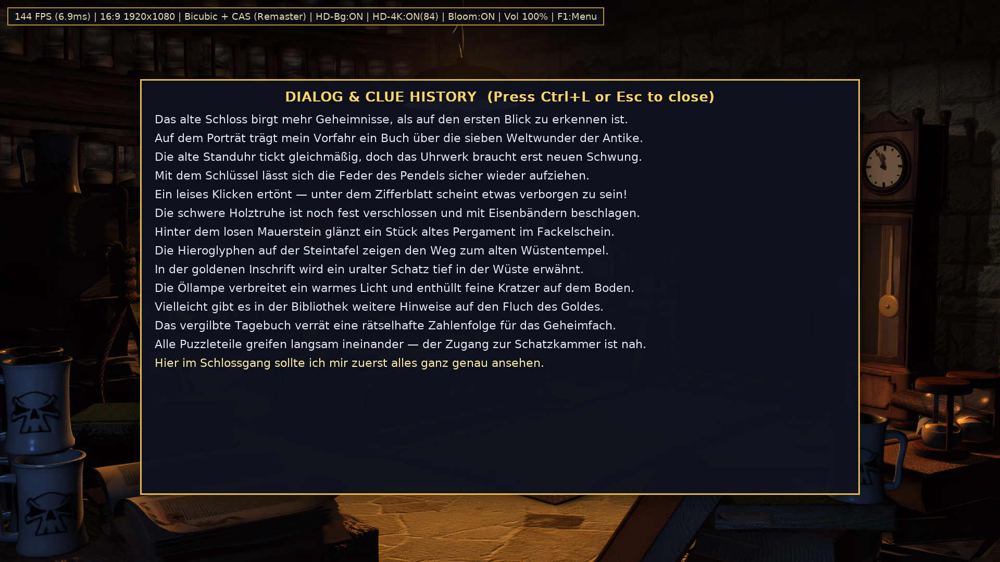

<a id="deutsch"></a>

<p align="center">
  <strong>🇩🇪 Deutsch</strong> · <a href="#english">🇬🇧 English</a>
</p>

<br>

# Moorhuhn Adventure 2: Der Fluch des Goldes — Native Linux Remastered Engine (v5)

Ein vollständiger **eigenständiger x86-32-zu-Linux-x86_64 Static Recompiler** sowie eine **modernisierte OpenGL-3.3-Core-Remaster-Engine** für *Moorhuhn Adventure 2: Der Fluch des Goldes* (`mha2.exe`) — nativ portiert auf Linux mit **OpenGL 3.3 Core**, **SDL2**, **SDL2_ttf** und **FFmpeg**, ganz **ohne Wine, ohne Emulator, ohne Windows-DLLs und ohne Ghidra zur Build-Zeit**.

> **Rechtlicher Hinweis / IP-Hinweis:** *Moorhuhn* / *Crazy Chicken* ist eine eingetragene Marke der ak tronic Software & Services GmbH. Dieses Repository enthält **ausschließlich** Clean-Room-Recompiler-Tooling, Asset-Extraktoren und eine native Linux-Kompatibilitätsschicht. Es sind keinerlei Original-Binärdateien, urheberrechtlich geschützte Spielinhalte oder aus der Exe generierter C-Code enthalten — du benötigst deine eigene legal erworbene Kopie des Spiels.
>
> Siehe [CHANGELOG.md](CHANGELOG.md) für den vollständigen Versionsverlauf von `v1` (erste statische Rekompilierung) bis `v5.3`.

<br>

---

<br>

## Showcase (Original 2005 vs. 4K-Remaster v5)

<br>

### Splitscreen-Vergleich — Schlossgang (2005 `800×450` vs. Live-4K-Remaster)



<br>

### Direktvergleich & 1:1-Native-4K-Detailzooms


<br>

### Ingame-4K-Nahaufnahme & interaktiver Hotspot-Highlighter (`Leertaste` / `H`)



<br>

### Remastered-Widescreen-Hauptmenü (Clean-Room-3D-Goldschrift & 16:9-Erweiterung)



<br>

### Interaktives 3-Tab-Einstellungsmenü im Spiel (`F1`)


<br>

### Dialog- & Hinweisverlauf (`Strg+L`) & Live-Statistik-HUD (`F3`)



<br>

---

<br>

## Modernisierte Engine-Features (v5)

- **100 % eigenständiger Static Recompiler** ([recomp/lift.py](recomp/lift.py)):
  - Erkennt automatisch alle 8.100+ Funktionen, 121 MSVC-Switch-Tabellen (inklusive negativ indizierter und 1-basierter `memcpy`/`memmove`-Tabellen) sowie alle MSVC-C++-EH-`FuncInfo`-Unwind/Catch-Handler direkt aus deiner bereitgestellten `mha2.exe` mit **null Lift-Fehlern** und ohne Ghidra-Abhängigkeit.
  - Enthält einen eigenständigen Extraktor für legale Spielkopien ([tools/extract_game.py](tools/extract_game.py)) mit Unterstützung für Wise `Setup.EXE` und Mode-1/2352-CD-ROM-Images (`.bin`/`.iso`) inklusive vollständiger CRC-32-Prüfung.

- **Unverzerrtes echtes Widescreen (`16:10` & `16:9`) + Ambient-Blur-4:3-Sidebars (`F12`)**:
  - Erkennt automatisch native `800×450`-Spielräume/-Minispiele (16:9) gegenüber `800×600`-Menüs (4:3).
  - **16:10 Smart (`800×500` → exakte `3,2×`-Skalierung auf `2560×1600`, 0 % Streckung, 0 px schwarze Balken)**: voller `800×450`-Raum + dediziertes `50 px` Inventar-Dock unten mit sanft schattierten HUD-Overlays oben.
  - **16:9 Cinema (`800×450`)**: randloses 16:9-Gameplay mit transparenten On-Demand-Overlays oben & unten.
  - **4:3-Menüs**: seitenverhältnistreue Darstellung mit optionalen weichgezeichneten Ambient-Sidebars.

- **Interaktives 3-Tab-Grafik- & Remaster-FX-Menü im Spiel (`F1`), Dialog-Log (`Strg+L`) & Clean-Room-Hauptmenü-Titel**:
  - Per Maus und Tastatur bedienbares 3-Tab-Menü (`1. DISPLAY`, `2. POST-FX`, `3. ASSETS & TEXT`) für Auflösungs-Presets (`800×600`–`2560×1600`), Seitenverhältnis, Shader, Bloom, Color Grading, Silhouetten-AA, Vignette, Szenenübergänge, HD-Assets sowie Lautstärke/Hall/EQ — automatisch gespeichert in `mha2_settings.ini`.
  - Enthält außerdem einen durchsuchbaren Dialog- & Hinweisverlauf (`Strg+L`), das kompakte `F3`-Performance-HUD sowie den prozedural in OpenGL/SDL2 gerenderten **3D-Goldschriftzug „REMASTERED“** im Hauptmenü (Clean-Room, aktiv im 4K-HD- sowie im Klassikmodus).

- **Multi-Pass OpenGL 3.3 FBO Post-Processing & weiche Szenen-Überblendungen**:
  - **Emissiver Bloom** (`Off / Subtle / Medium / Rich`): Viertelauflösungs-`GL_RGBA16F`-Bright-Pass + zweifacher separabler 9-Tap-Gauß-Blur für Kerzen, Fackeln, Kronleuchter und Goldartefakte.
  - **Color Grading & Vibrance** (`Original / Remastered Rich / Cinematic Warm / Crisp Daylight`).
  - **Sprite-Silhouetten-AA & Anti-Banding-Dithering**: leichtes FXAA-Kantenglätten + Dreiecksrauschen-Dithering gegen Banding.
  - **Weiche 210 ms Cubic-Ease-Out-Raumblenden**: Zero-Copy-Dual-FBO-Übergänge zwischen Räumen und Menüs.

- **KI-4K-Hintergründe + native GPU-4×-RGBA-Sprites (`F6`)** ([runtime/hd_assets.c](runtime/hd_assets.c), [tools/upscale_ai.py](tools/upscale_ai.py)):
  - Kombiniert 4K-Hintergründe (`3200×1800` / `3200×2400`) sowohl für Menüs (`800×600`) als auch für Spielräume (`800×450`) mit einem O(1)-dimensionsgruppierten LRU-GPU-Renderer für 4×-RGBA-Charaktere, Requisiten, Inventarsymbole, Buttons und Cursor (`hd_assets/sprites/`), inkl. Festplatten-Indexcache für sofortigen Start.

- **Monitor-DPI-Vektortext & Untertitel (`F5`)** & **High-Refresh-Cursor (`F10`)**:
  - Gestochen scharfer TrueType-Vektortext in nativer Monitor-Auflösung (nach dem Post-FX gerendert) sowie ein entkoppelter 4×-HD-Cursor mit voller Monitor-Bildwiederholrate (120/144/240 Hz).

- **Echte 32-Bit-Farbtiefe (`Mode 888`), 7 Upscaling-Shader (inkl. AMD FidelityFX FSR 1.0) & 48-kHz-Audio-Mixer**:
  - Bicubic+CAS, Lanczos3+CAS, Edge-Smooth, Bilinear, Nearest, Subtle CRT und AMD FidelityFX FSR 1.0 (`EASU + RCAS`); Float32-48-kHz-Catmull-Rom-Mixer mit Hall und Mastering-EQ (`F7`/`F8`/`F9`).

- **Remastered FMV-Zwischensequenzen** ([runtime/win32_avi.c](runtime/win32_avi.c), [tools/upscale_videos.py](tools/upscale_videos.py)):
  - Echtzeit-GPU-Deblocking, Anti-Ringing und Schärfung für die 2005er Cinepak-AVIs sowie automatische lippensynchrone Wiedergabe optionaler HD-MP4/MKV-Cutscenes aus `hd_assets/videos/`.

- **Schnellspeichern & -laden (`Strg+S` / `Strg+O`, Controller: Steuerkreuz ↑/↓)**:
  - Steuert den originalen Speicherbildschirm des Spiels (originaler Speichercode, originale Vorschaubilder) in den festen Schnellspeicher-Slot 9; ein manueller Spielstand in Slot 9 wird nie überschrieben. Nur beim Erkunden eines Raums verfügbar (nicht in Zwischensequenzen, Dialogen oder Menüs).

- **Frei belegbare Tasten & Controller (`F1` → `4. CONTROLS`) & Steam Deck** ([docs/STEAM_DECK.md](docs/STEAM_DECK.md)):
  - Alle Remaster-Tastenkürzel mit je zwei Tastenkombinationen; Controller-Tasten über `pad_*` in `mha2_settings.ini`. Zusätzlich skalierbare Overlay-Texte (Dialogverlauf mit Zeilenumbruch, Hotspot-Beschriftungen, Hinweise; `100–200 %`).

- **Behobene Fehler des Originalspiels & robuste Laufzeit**:
  - Atomarer Ersatz für den in sieben `ObjMutex`-Methoden inline kopierten, nicht-atomaren Spinlock (inkl. erzwungenem Lock-Diebstahl), Absturz bei zufälliger Ambient-Variante ohne geladene Ressource (`0x0042a820`), Hotspot-Hervorhebung in 11 Raum- und 5 Minispiel-Unterklassen, Absturz bzw. unsichtbare Phantom-Knöpfe bei `Tab` nach dem Laden eines Spielstands (Fokus blieb auf dem geschlossenen Speicherbildschirm), korrekte x87-`FIST`/`#DE`-Semantik.
  - Abstürze schreiben einen Bericht mit Gastadresse, Registern und Gast-Aufrufstapel nach `mha2_crash.log`; `--strict-mem` schützt die Gast-NULL-Seite zur Fehlersuche.

- **Tests & Regressionen** ([docs/REPLAY.md](docs/REPLAY.md)):
  - `make test` (Unit- & Stresstests) und `tools/regress.sh` (headless, in einer Sandbox ohne Zugriff auf echte Spielstände): skriptgesteuerte Eingabe-Wiedergabe (`--record` / `--replay`) durch Hauptmenü, Neues Spiel, Raumwechsel, Overlays, Schnellspeichern und Controller.

<br>

---

<br>

## Kompilieren aus deiner eigenen legalen Spielkopie

<br>

### NixOS (`nix-shell`)

```bash
# 1. Legal erworbenes CD-Image (.bin/.iso) oder Wise Setup.EXE nach game_files/ extrahieren:
nix-shell --run "python3 tools/extract_game.py '/pfad/zu/Setup.EXE' -o game_files"
# (alternativ bestehendes Installationsverzeichnis mit mha2.exe, mha2.dat, *.avi nach game_files/ kopieren)

# 2. mha2.exe in C liften (100 % eigenständig, kein Ghidra nötig) und natives x86_64-ELF kompilieren:
nix-shell --run "make lift && make -j$(nproc)"

# 3. Spielen!
./play.sh
```

<br>

### Standard-Linux (Ubuntu / Debian / Fedora / Arch)

Benötigte Build-Abhängigkeiten installieren:

- **Compiler & Build-Tools:** `gcc`, `make`, `pkg-config`, `python3`, `python3-capstone`
- **Entwicklungs-Header:** `SDL2` (`libsdl2-dev`), `SDL2_ttf` (`libsdl2-ttf-dev`), `FFmpeg` (`libavformat-dev`, `libavcodec-dev`, `libswscale-dev`, `libavutil-dev`) und `OpenGL` (`libgl-dev`)

```bash
# 1. Eigene legale Spieldateien in game_files/ ablegen (oder mit tools/extract_game.py extrahieren):
python3 tools/extract_game.py '/pfad/zu/Setup.EXE' -o game_files

# 2. mha2.exe liften und das native x86_64-Binary kompilieren:
make lift && make -j"$(nproc)"

# 3. Starten (prüft vorher automatisch auf Updates, siehe unten):
./play.sh
```

<br>

### Automatische Updates

Wer das Projekt per `git clone https://github.com/Mag1cByt3s/mha2-remastered.git` installiert hat und mit `./play.sh` startet, bekommt neue Versionen automatisch:

- Vor jedem Start prüft [tools/update.sh](tools/update.sh) (max. 20 s, offline wird einfach übersprungen), ob ein neues **Release** (Git-Tag `vX.Y.Z`) veröffentlicht wurde, aktualisiert den Quellcode und kompiliert neu. Danach erscheint im Hauptmenü kurz *„Updated to vX.Y.Z“*.
- **Spielstände, Einstellungen, Spieldateien und HD-Assets bleiben unverändert** (`game_files/`, `mha2_settings.ini`, `hd_assets/` sind nicht Teil des Repositorys). Zusätzlich werden Spielstände und Einstellungen vor jedem Update nach `backups/update-…/` gesichert (die letzten 10).
- Eigene Änderungen am Code werden nie überschrieben – dann wird das Update nur gemeldet. Schlägt das Kompilieren fehl, startet die vorherige Version weiter (Log: `build/update.log`).
- Abschalten: `./play.sh --no-update`, `MHA2_NO_UPDATE=1` oder `auto_update=0` in `mha2_settings.ini`. Manuell: `tools/update.sh`.
- Einmalig für ältere Installationen (ohne Updater): `git pull && ./play.sh`.

<br>

### Portables Linux-Release-Bundle

Erstellt ein eigenständiges, distributionsübergreifendes `.tar.gz`-Bundle über den Ubuntu-22.04-Builder-Container (`glibc 2.35`, `podman` oder `docker`):

```bash
make lift
bash tools/package_portable_linux.sh            # Komplettpaket (persönliche Nutzung)
bash tools/package_portable_linux.sh --split    # kleines Runtime-Paket + separates HD-Asset-Paket, ohne Spieldateien
```

Installation des geteilten Releases (eigene Spieldateien, gemeinsames Datenverzeichnis `~/.local/share/mha2-remastered/`): [docs/INSTALL.md](docs/INSTALL.md).

<br>

### Portables Bundle aktualisieren

Portable Bundles aktualisieren sich nicht selbst (kein Git, kein Compiler). Ein Update ist das kleine Runtime-Archiv (`…_Runtime.tar.gz`, ca. 12 MB), das mit `bash tools/package_portable_linux.sh --split` aus dem aktuellen Release gebaut wird – es wird einfach **über** den bestehenden Spielordner entpackt:

```bash
# 1. Spiel beenden. Optionale Sicherheitskopie von Spielständen + Einstellungen:
cd /pfad/zum/Spielordner
cp -a game_files/mha2.sav ~/mha2_saves_backup; cp mha2_settings.ini ~/ 2>/dev/null

# 2. Neues Runtime-Archiv über den Ordner entpacken (funktioniert auch, wenn der Ordner umbenannt wurde):
tar -xzf ~/Downloads/Moorhuhn_Adventure2_Remastered_Linux_x86_64_Runtime.tar.gz --strip-components=1 -C .

# 3. Wie gewohnt starten – der Titel im F1-Menü (und die Datei VERSION) zeigt die neue Version:
./PLAY.sh
```

- Ersetzt werden nur Programmdateien (`mha2_linux`, `lib/`, `fonts/`, `PLAY.sh`, Doku). **Spielstände (`game_files/mha2.sav/`), `mha2_settings.ini`, Spieldateien, Screenshots und `hd_assets/` bleiben unverändert** – das Archiv enthält keine dieser Dateien.
- Das funktioniert auch für ältere Komplett-Bundles (Spieldateien + HD-Assets in einem Archiv). Das 5-GB-HD-Asset-Paket muss nur erneut entpackt werden (`tar -xf …_HD_Assets.tar --strip-components=1 -C .`), wenn sich die HD-Assets geändert haben.
- Wer automatische Updates möchte, installiert stattdessen per `git clone` (siehe *Automatische Updates*); Spielstände lassen sich übernehmen, indem `game_files/mha2.sav/` und `mha2_settings.ini` in die neue Installation kopiert werden.

<br>

---

<br>

## 4K-KI-HD-Asset-Pack erstellen (`hd_assets/`)

```bash
# 4K-Hintergründe + 4×-RGBA-Sprites per Vulkan-GPU generieren:
nix-shell --run "python3 tools/upscale_ai.py --all"

# FMV-Zwischensequenzen (mha2il/ol/sl.avi) nach hd_assets/videos/ hochskalieren:
nix-shell --run "python3 tools/upscale_videos.py --scale 2"

# Oder originale 1×-Assets manuell inspizieren / extrahieren:
nix-shell --run "python3 tools/extract_assets.py --list"
nix-shell --run "python3 tools/extract_assets.py --images -o extracted_assets"
```

<br>

---

<br>

## Starten & CLI-Optionen

```bash
./play.sh                                       # Standard Remastered v5 (lädt mha2_settings.ini)
./play.sh --fullscreen --hud                    # Rahmenloser Vollbildmodus + Live-HUD
./play.sh --aspect 16:10 --grade remastered     # 16:10-Smart-Widescreen & Color Grading erzwingen
./play.sh --16bit --no-hd-assets --no-hd-sprites --no-hd-text --no-bloom --grade original  # Purer 2005er-Look
./play.sh --record sitzung.rec                  # Eingaben aufzeichnen; --replay sitzung.rec spielt sie ab
./play.sh --strict-mem                          # Debug: Gast-NULL-Zeiger-Zugriffe sofort melden
./play.sh --no-update                           # ohne Update-Prüfung starten
```

<br>

### Tastenkürzel im Spiel

| Taste | Aktion |
|---|---|
| **F1** | Einstellungsmenü öffnen/schließen (Display, Post-FX, Assets & Text, Steuerung) |
| **F2** | Live-Splitscreen-Vergleich Vorher/Nachher (2005 vs. 4K-Remaster) |
| **F3** | Live-GPU-Statistik-HUD ein-/ausblenden |
| **F4** | VSync / High-FPS-Modus durchschalten |
| **F5** | Monitor-DPI-Vektortext & Untertitel ein-/ausblenden |
| **F6** | HD-Asset-Pack-Override (`hd_assets/`) ein-/ausschalten |
| **F7 / F8 / F9** | Gesamtlautstärke leiser / lauter / stumm |
| **F10** | Entkoppelten High-Refresh-Cursor ein-/ausschalten |
| **F11** oder **Alt+Enter** | Rahmenlosen Vollbildmodus umschalten |
| **F12** | Widescreen-Seitenverhältnis wechseln (`Auto` / `16:10` / `16:9` / `4:3`) |
| **Leertaste** oder **H** | Gedrückt halten, um interaktive Hotspots im Raum hervorzuheben |
| **Strg+L** (`Ctrl+L`) | Dialog- & Hinweisverlauf öffnen/schließen |
| **Umschalt** (`Shift`) | Gedrückt halten für 2× Schnelllauf-Geschwindigkeit |
| **Strg+P** oder **Druck** | Sauberen 4K-PNG-Screenshot speichern (`screenshots/`) |
| **Strg+S** / **Strg+O** | Schnellspeichern / Schnellladen (Slot 9) |
| **Pfeiltasten** / **W A S D** | Moorhuhn in Szenen mit Tastatursteuerung lenken (Space-Invaders-Minispiel, dunkler Gang hinter dem zersägten Gitter) |
| **ESC** | Zwischensequenzen überspringen / Spielmenü / F1-Menü schließen |
| **Controller** | Linker Stick = Cursor, A = Klick, B = Rechtsklick, X = Hotspots, Y/LB = Schnelllauf, Back = F1, Start = ESC, Steuerkreuz ↑/↓ = Schnellspeichern/-laden |

Alle Remaster-Tastenkürzel sind unter `F1` → `4. CONTROLS` frei belegbar (Standardwerte oben).

<br>

---

<br>

## Lizenz

Der Clean-Room-Static-Recompiler, die native Linux-Laufzeitumgebung und alle Asset-Tools in diesem Repository stehen unter der **MIT-Lizenz** — Details siehe [LICENSE](LICENSE). Original-Spieldateien, Grafiken, Tonspuren und Videos bleiben Eigentum der jeweiligen Rechteinhaber und sind nicht Teil dieses Repositories.

<br>

---

<br>

<a id="english"></a>

<p align="center">
  <a href="#deutsch">🇩🇪 Deutsch</a> · <strong>🇬🇧 English</strong>
</p>

<br>

# Moorhuhn Adventure 2: Der Fluch des Goldes — Native Linux Remastered Engine (v5)

A full **standalone x86-32 to native Linux x86_64 static recompiler** and **modernized OpenGL 3.3 Core remaster engine** for *Moorhuhn Adventure 2: Der Fluch des Goldes* (`mha2.exe`), ported natively to Linux with **OpenGL 3.3 Core**, **SDL2**, **SDL2_ttf**, and **FFmpeg** — with **no Wine, no emulator, no Windows DLLs, and no Ghidra required at build time**.

> **Legal / IP Notice:** *Moorhuhn* / *Crazy Chicken* is a registered trademark of ak tronic Software & Services GmbH. This repository contains **only** original clean-room recompiler tooling, asset extractors, and a Linux runtime compatibility layer. No original game binaries, copyrighted assets, or lifted C code are included — you must supply your own legally owned copy of the game.
>
> See [CHANGELOG.md](CHANGELOG.md) for the full version history from `v1` static recompilation through `v5.3`.

<br>

---

<br>

## Showcase (Original 2005 vs 4K Remaster v5)

<br>

### Split-Screen Comparison — Castle Hallway (2005 `800×450` vs Live 4K Remaster)


<br>

### Side-by-Side & 1:1 Native 4K Detail Zooms


<br>

### In-Game 4K Close-Up & Interactive Hotspot Highlighter (`Space` / `H`)


<br>

### Remastered Widescreen Main Menu (Clean-Room Procedural 3D Gold Title & 16:9 Wings)


<br>

### Interactive 3-Tab In-Game Settings Menu (`F1`)


<br>

### In-Game Dialog & Clue History Log (`Ctrl+L`) & Live Stats HUD (`F3`)


<br>

---

<br>

## Modernized Engine Features (v5)

- **100% Standalone Static Recompiler** ([recomp/lift.py](recomp/lift.py)):
  - Automatically discovers all 8,100+ functions, 121 MSVC switch tables (including negative-indexed and 1-based `memcpy`/`memmove` tables), and all MSVC C++ EH `FuncInfo` unwind/catch handlers directly from a user-supplied `mha2.exe` with **zero lift errors** and zero Ghidra dependency.
  - Includes a standalone legal-copy disc/installer extractor ([tools/extract_game.py](tools/extract_game.py)) supporting both Wise `Setup.EXE` and raw Mode 1/2352 `.bin`/`.iso` CD-ROM images with full CRC-32 verification.

- **Zero-Stretch True Widescreen (`16:10` & `16:9`) + Ambient Blur 4:3 Sidebars (`F12`)**:
  - Automatically detects native `800×450` (16:9) gameplay rooms/minigames vs `800×600` (4:3) menus.
  - **16:10 Smart (`800×500` → exact `3.2×` on `2560×1600`, 0% stretch, 0px black bars)**: full `800×450` room + dedicated `50px` bottom inventory dock with soft drop-shadow top HUD overlays.
  - **16:9 Cinema (`800×450`)**: edge-to-edge 16:9 gameplay with transparent on-demand top & bottom overlays.
  - **4:3 Menus**: aspect-correct with optional blurred ambient sidebars.

- **Interactive 3-Tab In-Game Settings Menu (`F1`), Dialog History Log (`Ctrl+L`) & Clean-Room Main Menu Title**:
  - Mouse + keyboard 3-tab menu (`1. DISPLAY`, `2. POST-FX`, `3. ASSETS & TEXT`) controlling resolution presets (`800×600`–`2560×1600`), aspect mode, shaders, bloom, color grading, silhouette AA, vignette, transitions, HD assets, and volume/reverb/EQ — automatically saved to `mha2_settings.ini`.
  - Also includes a `Ctrl+L` Dialog & Clue History Log, an `F3` live performance HUD, and a clean-room procedurally rendered **3D brushed-gold `"REMASTERED"`** Main Menu badge (active in both 4K HD and classic modes).

- **Multi-Pass OpenGL 3.3 FBO Post-Processing & Smooth Scene Crossfades**:
  - **Emissive Bloom** (`Off / Subtle / Medium / Rich`): quarter-res `GL_RGBA16F` warm-weighted bright-pass + dual separable 9-tap Gaussian blur for candles, torches, chandeliers, and gold artifacts.
  - **Color Grading & Vibrance** (`Original / Remastered Rich / Cinematic Warm / Crisp Daylight`).
  - **Sprite Silhouette AA & Anti-Banding Dithering**: lightweight FXAA edge smoothing + triangular-noise output dithering.
  - **Smooth 210 ms Cubic Ease-Out Room Crossfades**: zero-copy dual-FBO transitions between rooms and menus.

- **AI 4K Neural Backgrounds + Native GPU 4× RGBA Sprites (`F6`)** ([runtime/hd_assets.c](runtime/hd_assets.c), [tools/upscale_ai.py](tools/upscale_ai.py)):
  - Composites 4K (`3200×1800` / `3200×2400`) Real-ESRGAN backgrounds for both menus (`800×600`) and gameplay rooms (`800×450`), plus an O(1) dimension-bucketed LRU GPU renderer for 4× RGBA foreground characters, props, inventory icons, buttons, and cursors (`hd_assets/sprites/`), all cached to disk for instant startup.

- **Native Monitor-DPI Vector Text & Subtitles (`F5`)** & **High-Refresh Decoupled Cursor (`F10`)**:
  - Crisp native monitor-DPI TrueType text rendered post-FX, plus a 4× HD decoupled cursor rendered at full monitor refresh rate (120/144/240Hz).

- **True 32-bit Color (`Mode 888`), 7 Upscaling Shaders (incl. AMD FidelityFX FSR 1.0), & 48 kHz Cubic Audio Mixer**:
  - Bicubic+CAS, Lanczos3+CAS, Edge-Smooth, Bilinear, Nearest, Subtle CRT, and AMD FidelityFX FSR 1.0 (`EASU + RCAS`); Float32 48 kHz Catmull-Rom audio mixer with reverb and mastering EQ (`F7`/`F8`/`F9`).

- **Remastered FMV Cutscenes** ([runtime/win32_avi.c](runtime/win32_avi.c), [tools/upscale_videos.py](tools/upscale_videos.py)):
  - Real-time GPU deblocking + anti-ringing + sharpening for 2005 Cinepak AVIs, plus automatic drop-in HD MP4/MKV cutscene playback from `hd_assets/videos/` in full audio sync.

- **Quick Save & Quick Load (`Ctrl+S` / `Ctrl+O`, controller: D-pad Up/Down)**:
  - Drives the game's own save screen (original save code, original thumbnails) into the dedicated quick slot 9; a manual save in slot 9 is never overwritten. Available while exploring a room (not during cutscenes, dialogs or menus).

- **Rebindable Keys & Controller (`F1` → `4. CONTROLS`) & Steam Deck** ([docs/STEAM_DECK.md](docs/STEAM_DECK.md)):
  - Every remaster hotkey takes two key chords; controller buttons via `pad_*` in `mha2_settings.ini`. Plus scalable overlay text (word-wrapped dialog log, hotspot labels, toasts; `100–200%`).

- **Original-Game Bugfixes & a Hardened Runtime**:
  - Atomic replacement for the non-atomic spinlock MSVC inlined into seven `ObjMutex` methods (including its forced lock-steal), a crash when a random ambient variant is picked before any resource is loaded (`0x0042a820`), hotspot highlighting in 11 room and 5 minigame subclasses, a crash / invisible phantom buttons when pressing `Tab` after loading a game (focus stayed on the closed save screen), exact x87 `FIST` / `#DE` semantics.
  - Crashes write a report with the guest address, registers and guest call stack to `mha2_crash.log`; `--strict-mem` protects the guest NULL page for debugging.

- **Tests & Regressions** ([docs/REPLAY.md](docs/REPLAY.md)):
  - `make test` (unit & stress tests) and `tools/regress.sh` (headless, sandboxed — real savegames are never touched): scripted input replay (`--record` / `--replay`) through the main menu, a new game, room transitions, overlays, quick save and controller input.

<br>

---

<br>

## Building From Your Own Legal Copy

<br>

### NixOS (`nix-shell`)

```bash
# 1. Extract your legally owned CD image (.bin/.iso) or Wise Setup.EXE into game_files/:
nix-shell --run "python3 tools/extract_game.py '/path/to/Setup.EXE' -o game_files"
# (or copy your existing installed game directory containing mha2.exe, mha2.dat, *.avi into game_files/)

# 2. Lift mha2.exe to C (100% standalone, no Ghidra required) and compile native x86_64 ELF:
nix-shell --run "make lift && make -j$(nproc)"

# 3. Play!
./play.sh
```

<br>

### Standard Linux (Ubuntu / Debian / Fedora / Arch)

Install the build dependencies:

- **Compilers & build tools:** `gcc`, `make`, `pkg-config`, `python3`, `python3-capstone`
- **Development headers:** `SDL2` (`libsdl2-dev`), `SDL2_ttf` (`libsdl2-ttf-dev`), `FFmpeg` (`libavformat-dev`, `libavcodec-dev`, `libswscale-dev`, `libavutil-dev`), and `OpenGL` (`libgl-dev`)

```bash
# 1. Supply your legally owned game files in game_files/ (or extract them with tools/extract_game.py):
python3 tools/extract_game.py '/path/to/Setup.EXE' -o game_files

# 2. Lift mha2.exe to C and build the native x86_64 executable:
make lift && make -j"$(nproc)"

# 3. Launch (checks for updates first, see below):
./play.sh
```

<br>

### Automatic Updates

If you installed via `git clone https://github.com/Mag1cByt3s/mha2-remastered.git` and start the game with `./play.sh`, new versions arrive automatically:

- Before every launch, [tools/update.sh](tools/update.sh) checks (at most 20 s; offline is simply skipped) whether a new **release** (git tag `vX.Y.Z`) was published, updates the source and rebuilds. The main menu then briefly shows *"Updated to vX.Y.Z"*.
- **Savegames, settings, game files and HD assets are never touched** (`game_files/`, `mha2_settings.ini`, `hd_assets/` are not part of the repository). On top of that, saves and settings are backed up to `backups/update-…/` before every update (the last 10 are kept).
- Your own code changes are never overwritten — the update is only reported then. If the build fails, the previous version keeps running (log: `build/update.log`).
- Turn it off: `./play.sh --no-update`, `MHA2_NO_UPDATE=1`, or `auto_update=0` in `mha2_settings.ini`. Manually: `tools/update.sh`.
- One time for older installs (without the updater): `git pull && ./play.sh`.

<br>

### Portable Linux Release Bundle

To package a self-contained portable x86_64 `.tar.gz` bundle using the Ubuntu 22.04 (`glibc 2.35`) builder container (`podman` or `docker`):

```bash
make lift
bash tools/package_portable_linux.sh            # all-in-one bundle (personal use)
bash tools/package_portable_linux.sh --split    # small runtime archive + separate HD asset pack, no game files
```

Installing the split release (your own game files, shared data directory `~/.local/share/mha2-remastered/`): [docs/INSTALL.md](docs/INSTALL.md).

<br>

### Updating a Portable Bundle

Portable bundles do not update themselves (no git, no compiler). An update is the small runtime archive (`…_Runtime.tar.gz`, about 12 MB) built from the current release with `bash tools/package_portable_linux.sh --split` — simply extract it **over** the existing game folder:

```bash
# 1. Quit the game. Optional safety copy of saves + settings:
cd /path/to/the/game/folder
cp -a game_files/mha2.sav ~/mha2_saves_backup; cp mha2_settings.ini ~/ 2>/dev/null

# 2. Extract the new runtime archive over the folder (works even if the folder was renamed):
tar -xzf ~/Downloads/Moorhuhn_Adventure2_Remastered_Linux_x86_64_Runtime.tar.gz --strip-components=1 -C .

# 3. Start as usual — the F1 menu title (and the VERSION file) shows the new version:
./PLAY.sh
```

- Only program files are replaced (`mha2_linux`, `lib/`, `fonts/`, `PLAY.sh`, docs). **Savegames (`game_files/mha2.sav/`), `mha2_settings.ini`, game files, screenshots and `hd_assets/` stay untouched** — the archive contains none of them.
- This also works for older all-in-one bundles (game files + HD assets in one archive). The 5 GB HD asset pack only needs to be extracted again (`tar -xf …_HD_Assets.tar --strip-components=1 -C .`) when the HD assets changed.
- For automatic updates, install via `git clone` instead (see *Automatic Updates*); carry your saves over by copying `game_files/mha2.sav/` and `mha2_settings.ini` into the new install.

<br>

---

<br>

## Building the 4K AI Neural HD Pack (`hd_assets/`)

```bash
# Build 4K detail-preserving backgrounds (4x_NMKD-Siax_200k) + 4x RGBA sprites (ultrasharp-4x) on your Vulkan GPU:
nix-shell --run "python3 tools/upscale_ai.py --all"

# Remaster the FMV cutscenes (mha2il/ol/sl.avi) to 1600x1200 H.264 MP4 in hd_assets/videos/:
nix-shell --run "python3 tools/upscale_videos.py --scale 2"

# Or extract raw 1x assets manually:
nix-shell --run "python3 tools/extract_assets.py --list"
nix-shell --run "python3 tools/extract_assets.py --images -o extracted_assets"
```

<br>

---

<br>

## Launching & CLI Options

```bash
./play.sh                                       # Default Remastered v5 (loads mha2_settings.ini)
./play.sh --fullscreen --hud                    # Borderless fullscreen + live HUD
./play.sh --aspect 16:10 --grade remastered     # Force 16:10 Smart widescreen & color grading
./play.sh --16bit --no-hd-assets --no-hd-sprites --no-hd-text --no-bloom --grade original  # Pure 2005 look
./play.sh --record session.rec                  # record input; --replay session.rec plays it back
./play.sh --strict-mem                          # debug: report guest NULL-pointer accesses immediately
./play.sh --no-update                           # start without the update check
```

<br>

### In-Game Hotkeys

| Key | Action |
|---|---|
| **F1** | Open/Close the settings menu (Display, Post-FX, Assets & Text, Controls) |
| **F2** | Toggle Live Split-Screen Before / After Comparison (2005 vs 4K Remaster) |
| **F3** | Toggle live GPU stats HUD |
| **F4** | Cycle VSync / High-FPS mode |
| **F5** | Toggle Native Monitor-DPI Vector Text & Subtitles |
| **F6** | Toggle HD Asset Pack Override (`hd_assets/`) |
| **F7 / F8 / F9** | Master volume down / up / mute |
| **F10** | Toggle High-Refresh Decoupled Cursor |
| **F11** or **Alt+Enter** | Toggle borderless fullscreen |
| **F12** | Cycle Widescreen Aspect (`Auto` / `16:10` / `16:9` / `4:3`) |
| **Space** or **H** | Hold to highlight interactive hotspots in the room |
| **Ctrl+L** | Open/Close Dialog & Clue History Log |
| **Shift** | Hold for 2× fast-walk speed |
| **Ctrl + P** or **PrintScreen** | Save clean 4K PNG screenshot (`screenshots/`) |
| **Ctrl+S** / **Ctrl+O** | Quick save / quick load (slot 9) |
| **Arrow keys** / **W A S D** | Steer the Moorhuhn in keyboard-controlled scenes (Space Invaders minigame, dark corridor behind the sawn grate) |
| **ESC** | Skip cutscenes / open game menu / close F1 menu |
| **Controller** | Left stick = cursor, A = click, B = right click, X = hotspots, Y/LB = fast walk, Back = F1, Start = ESC, D-pad Up/Down = quick save/load |

Every remaster hotkey can be rebound under `F1` → `4. CONTROLS` (defaults above).

<br>

---

<br>

## License

The clean-room static recompiler, native Linux runtime, and asset-processing tooling in this repository are released under the **MIT License** — see [LICENSE](LICENSE) for details. Original game binaries, artwork, sound, and video assets remain the property of their respective copyright holders and are excluded from this repository.
