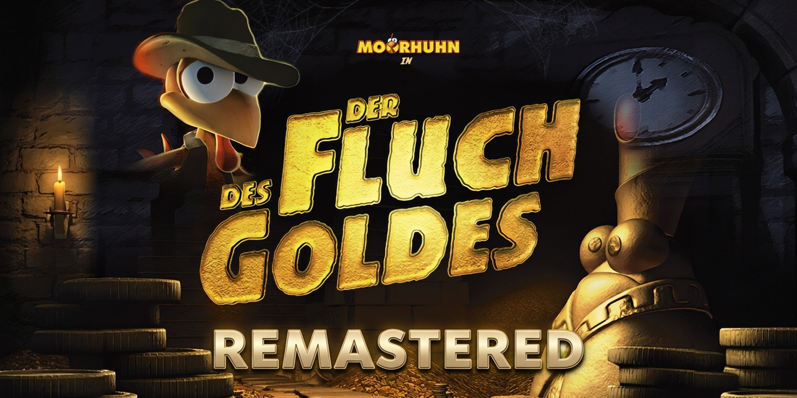
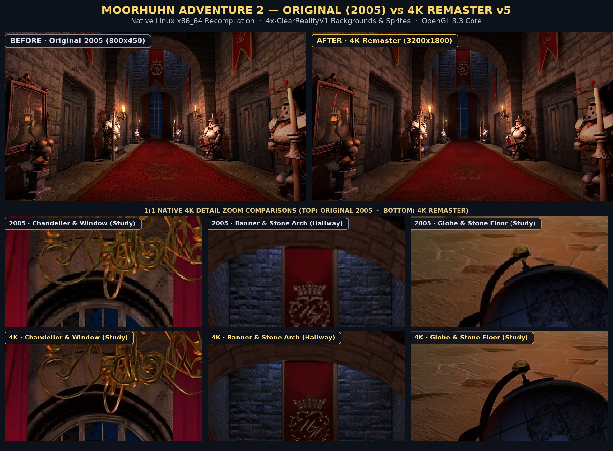
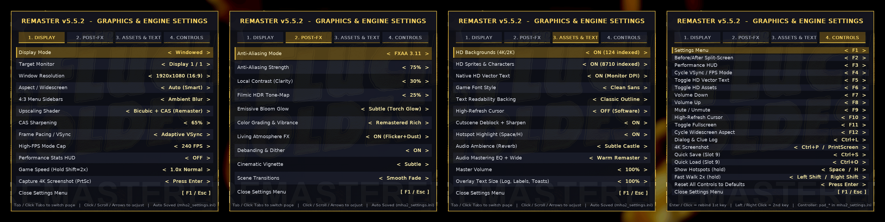
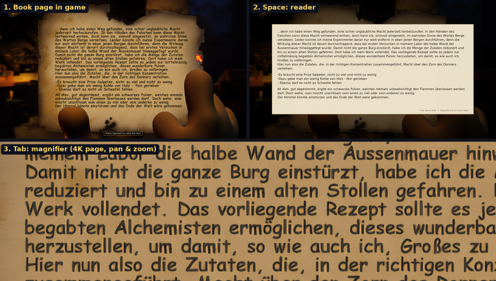

<a id="deutsch"></a>

<p align="center">
  <strong>🇩🇪 Deutsch</strong> · <a href="#english">🇬🇧 English</a>
</p>

<br>

# Moorhuhn Adventure 2: Der Fluch des Goldes — Native Linux Remastered Engine (v5)

Ein vollständiger **eigenständiger x86-32-zu-Linux-x86_64 Static Recompiler** sowie eine **modernisierte OpenGL-3.3-Core-Remaster-Engine** für *Moorhuhn Adventure 2: Der Fluch des Goldes* (`mha2.exe`) — nativ portiert auf Linux mit **OpenGL 3.3 Core**, **SDL2**, **SDL2_ttf** und **FFmpeg**, ganz **ohne Wine, ohne Emulator, ohne Windows-DLLs und ohne Ghidra zur Build-Zeit**.

> **Rechtlicher Hinweis / IP-Hinweis:** *Moorhuhn* / *Crazy Chicken* ist eine eingetragene Marke der ak tronic Software & Services GmbH. Dieses Repository enthält **ausschließlich** Clean-Room-Recompiler-Tooling, Asset-Extraktoren und eine native Linux-Kompatibilitätsschicht. Es sind keinerlei Original-Binärdateien, urheberrechtlich geschützte Spielinhalte oder aus der Exe generierter C-Code enthalten — du benötigst deine eigene legal erworbene Kopie des Spiels.
>
> Siehe [CHANGELOG.md](CHANGELOG.md) für den vollständigen Versionsverlauf von `v1` (erste statische Rekompilierung) bis zur aktuellen Version.

<br>

---

<br>

## Showcase (Original 2005 vs. 4K-Remaster v5)

<br>

### Splitscreen-Vergleich — Schlossgang (2005 `800×450` vs. Live-4K-Remaster)


<br>

### Direktvergleich & 1:1-Native-4K-Detailzooms



<br>

### Ingame-4K-Nahaufnahme & interaktiver Hotspot-Highlighter (`Leertaste` / `H`)


<br>

### Remastered-Widescreen-Hauptmenü (Clean-Room-3D-Goldschrift & 16:9-Erweiterung)


<br>

### Interaktives 4-Tab-Einstellungsmenü im Spiel (`F1`)



<br>

### Dialog- & Hinweisverlauf (`Strg+L`) & Live-Statistik-HUD (`F3`)


<br>

### Lesehilfe für Bücher & Briefe (`Leertaste`) & Lupe (`Tab`)


<br>

---

<br>

## Modernisierte Engine-Features (v5)

- **100 % eigenständiger Static Recompiler** ([recomp/lift.py](recomp/lift.py)):
  - Erkennt automatisch alle 8.100+ Funktionen, 121 MSVC-Switch-Tabellen (inklusive negativ indizierter und 1-basierter `memcpy`/`memmove`-Tabellen) sowie alle MSVC-C++-EH-`FuncInfo`-Unwind/Catch-Handler direkt aus deiner bereitgestellten `mha2.exe` mit **null Lift-Fehlern** und ohne Ghidra-Abhängigkeit.
  - Enthält einen eigenständigen Extraktor für legale Spielkopien ([tools/extract_game.py](tools/extract_game.py)) mit Unterstützung für Wise `Setup.EXE` und Mode-1/2352-CD-ROM-Images (`.bin`/`.iso`) inklusive vollständiger CRC-32-Prüfung.

- **Unverzerrtes echtes Widescreen (`16:10` & `16:9`) + Ambient-Blur-4:3-Sidebars (`F12`)**:
  - Erkennt automatisch native `800×450`-Spielräume/-Minispiele (16:9) gegenüber `800×600`-Menüs (4:3).
  - **16:10 Smart (`800×500` → exakte `3,2×`-Skalierung auf `2560×1600`, 0 % Streckung, 0 px schwarze Balken)**: voller `800×450`-Raum + dediziertes `50 px` Inventar-Dock unten mit sanft schattierten HUD-Overlays oben.
  - **16:9 Cinema (`800×450`)**: randloses 16:9-Gameplay mit transparenten On-Demand-Overlays oben & unten.
  - **4:3-Menüs**: seitenverhältnistreue Darstellung mit optionalen weichgezeichneten Ambient-Sidebars.

- **Interaktives 4-Tab-Einstellungsmenü im Spiel (`F1`), Dialog-Log (`Strg+L`) & Clean-Room-Hauptmenü-Titel**:
  - Per Maus, Tastatur und Controller bedienbares Menü mit vier Tabs (`1. DISPLAY`, `2. POST-FX`, `3. ASSETS & TEXT`, `4. CONTROLS`): Anzeigemodus & Zielmonitor, Auflösungs-Presets (`800×600`–`2560×1600`), Seitenverhältnis, Upscaling-Shader & CAS-Schärfe, VSync/FPS-Limit, Spieltempo (`1,0×` / `1,5×` / `2,0×`), Post-FX, HD-Assets, Schriftstil & Texthinterlegung, Overlay-Textgröße, Lautstärke/Hall/EQ und Tastenbelegung — automatisch gespeichert in `mha2_settings.ini`. Der Menütitel zeigt die installierte Version.
  - Enthält außerdem einen Verlauf der letzten Dialog- & Hinweiszeilen (`Strg+L`, bis zu 32 Zeilen), das kompakte `F3`-Performance-HUD sowie den prozedural in OpenGL/SDL2 gerenderten **3D-Goldschriftzug „REMASTERED“** im Hauptmenü (Clean-Room, aktiv im 4K-HD- sowie im Klassikmodus).

- **Multi-Pass OpenGL 3.3 FBO Post-Processing & weiche Szenen-Überblendungen**:
  - **Emissiver Bloom** (`Off / Subtle / Medium / Rich`): Viertelauflösungs-`GL_RGBA16F`-Bright-Pass + separabler 9-Tap-Gauß-Blur für Kerzen, Fackeln, Kronleuchter und Goldartefakte.
  - **Color Grading & Vibrance** (`Original / Remastered Rich / Cinematic Warm / Crisp Daylight`), **Filmisches HDR-Tone-Mapping** und **lokaler Kontrast (Clarity)** (je `0–100 %`), **Kino-Vignette** sowie **Living Atmosphere FX** (Fackelflackern & schwebender Staub).
  - **Kantenglättung** (`FXAA 3.11` / `SMAA 1x` / `SMAA + 3× Edge AA`, Stärke `0–100 %`) und **großflächiges Debanding** mit Dreiecksrauschen-Dithering gegen Farbstufen.
  - **Weiche 210 ms Cubic-Ease-Out-Raumblenden**: Zero-Copy-Dual-FBO-Übergänge zwischen Räumen und Menüs.

- **Neuronale 4K-Hintergründe + 4×-RGBA-Sprites (`F6`)** ([runtime/hd_assets.c](runtime/hd_assets.c), [tools/upscale_transformer.py](tools/upscale_transformer.py)):
  - 4K-Hintergründe (`3200×1800` / `3200×2400`, `4x-ClearRealityV1`) sowohl für Menüs (`800×600`) als auch für Spielräume (`800×450`), dazu 4×-RGBA-Charaktere, Requisiten, Inventarsymbole, Buttons und Cursor (`hd_assets/sprites/`), mehrteilige Animationsstreifen Bild für Bild hochskaliert. Verlustfreie WebP-Dateien, O(1)-dimensionsgruppierter LRU-GPU-Cache, Vorab-Dekodierung im Hintergrund und Festplatten-Indexcache für sofortigen Start; Widescreen-Hauptmenü mit erweiterten 4K-Seitenflügeln.

- **Monitor-DPI-Vektortext & Untertitel (`F5`)** & **High-Refresh-Cursor (`F10`)**:
  - Gestochen scharfer TrueType-Vektortext in nativer Monitor-Auflösung (nach dem Post-FX gerendert, Schriftstil `Clean Sans` / `Adventure Serif`) sowie ein entkoppelter 4×-HD-Cursor mit voller Monitor-Bildwiederholrate (120/144/240 Hz).

- **Echte 32-Bit-Farbtiefe (`Mode 888`), 7 Upscaling-Shader (inkl. AMD FidelityFX FSR 1.0) & 48-kHz-Audio-Mixer**:
  - Bicubic+CAS, Lanczos3+CAS, Edge-Smooth, Bilinear, Nearest, Subtle CRT und AMD FidelityFX FSR 1.0 (`EASU + RCAS`).
  - Float32-48-kHz-Mixer mit Catmull-Rom-Resampling, knackfreien Lautstärkerampen, Burghall (`Subtle Castle` / `Rich Hall`) und Mastering-EQ mit Stereoverbreiterung (`Warm Remaster` / `Studio Crisp`) im `F1`-Menü; Lautstärke über `F7`/`F8`/`F9`.

- **Remastered FMV-Zwischensequenzen** ([runtime/win32_avi.c](runtime/win32_avi.c), [tools/remaster_videos_4k.py](tools/remaster_videos_4k.py)):
  - Echtzeit-GPU-Deblocking, Anti-Ringing und Schärfung für die Original-Videos von 2005 sowie automatischer Austausch durch optionale HD-Cutscenes (MP4/MKV/WebM, bis `3200×2400`) aus `hd_assets/videos/`. Der Ton kommt wie im Original aus dem Spiel, das Bild läuft im Takt der Echtzeit mit.

- **Komfortfunktionen**:
  - **Hotspot-Hervorhebung** (`Leertaste`/`H` halten): markiert alle anklickbaren Objekte direkt aus dem Szenengraphen des Spiels, auch in Räumen und Minispielen mit eigener Logik.
  - **Lesehilfe für Bücher & Briefe** (`Leertaste`/`H` auf einer Buchseite, Controller: X) ([runtime/gl_page_reader.c](runtime/gl_page_reader.c)): zeigt den Text von Tagebüchern, Pergamenten, Grabinschrift und Aushängen als klare, skalierbare Schrift über der abgedunkelten Seite, Doppelseiten zweispaltig. `Tab` wechselt zur **Lupe**: die 4K-Seite vergrößert, schwenkbar mit Maus/Pfeiltasten, Zoom mit Mausrad/`+`/`-`. Schließen mit derselben Taste, `Esc` oder Klick. Die Texte werden beim Bau des HD-Pakets lokal aus den eigenen Spieldateien gelesen (`hd_assets/…/*.txt`, nie im Repository); Seiten, bei denen die Texterkennung nicht sicher ist, öffnen direkt die Lupe.
  - **Schnelllauf** (`Umschalt` halten = `2×`, dauerhaft `1,5×`/`2,0×` im `F1`-Menü), **4K-Screenshots** (`Strg+P` / `Druck`), rollierende **Sicherungskopie der Spielstände** (`game_files/mha2.sav/autosave_backup/`, höchstens alle 3 Minuten bei Raumwechseln) und optionaler Desktop-Starter ([tools/install_desktop.sh](tools/install_desktop.sh)).

- **Schnellspeichern & -laden (`Strg+S` / `Strg+O`, Controller: Steuerkreuz ↑/↓)**:
  - Steuert den originalen Speicherbildschirm des Spiels (originaler Speichercode, originale Vorschaubilder) in den festen Schnellspeicher-Slot 9; ein manueller Spielstand in Slot 9 wird nie überschrieben. Nur beim Erkunden eines Raums verfügbar (nicht in Zwischensequenzen, Dialogen oder Menüs).

- **Frei belegbare Tasten & Controller (`F1` → `4. CONTROLS`) & Steam Deck** ([docs/STEAM_DECK.md](docs/STEAM_DECK.md)):
  - 18 Remaster-Aktionen mit je zwei Tastenkombinationen; Controller-Tasten über `pad_*` in `mha2_settings.ini`. Zusätzlich skalierbare Overlay-Texte (Dialogverlauf mit Zeilenumbruch, Hotspot-Beschriftungen, Hinweise; `100–200 %`).

- **Behobene Fehler des Originalspiels von 2005**:
  - Atomarer Ersatz für den nicht-atomaren Spinlock, den MSVC in sieben `ObjMutex`-Methoden inline kopiert hat (inkl. erzwungenem Lock-Diebstahl nach 200 ms); Endlosschleife bei abgeschnittenen oder beschädigten Spielständen; künstliche 50–250-ms-Pause im Ladebildschirm; Absturz bei zufälliger Ambient-Variante ohne geladene Ressource (`0x0042a820`); Null-Zeiger-Zugriff im Raum-Objektlader; Handle-Leck beim Start; Absturz bzw. unsichtbare Phantom-Knöpfe bei `Tab` nach dem Laden eines Spielstands (Fokus blieb auf dem geschlossenen Speicherbildschirm).

- **Robuste Laufzeit**:
  - Exakte x86-/x87-Semantik (`FIST`, `div`/`idiv` mit `#DE`), abgesicherter 4-GiB-Gast-Adressraum, Windows-genaue Tastaturnachrichten (Pfeiltasten in den Szenen mit Tastatursteuerung).
  - Abstürze schreiben einen Bericht mit Gastadresse, Registern und Gast-Aufrufstapel nach `mha2_crash.log`; `--strict-mem` schützt die Gast-NULL-Seite zur Fehlersuche.

- **Tests & Regressionen** ([docs/REPLAY.md](docs/REPLAY.md)):
  - `make test` (Unit- & Stresstests, Updater-Szenarien) und `tools/regress.sh` (headless, in einer Sandbox ohne Zugriff auf echte Spielstände): skriptgesteuerte Eingabe-Wiedergabe (`--record` / `--replay`) durch Hauptmenü, Neues Spiel, Raumwechsel, Overlays, Schnellspeichern und Controller.

<br>

---

<br>

## Kompilieren aus deiner eigenen legalen Spielkopie

<br>

### NixOS (`nix-shell`)

```bash
# 1. Legal erworbenes CD-Image (.bin/.iso) oder Wise Setup.EXE nach game_files/ extrahieren:
nix-shell --run "python3 tools/extract_game.py '/pfad/zu/Setup.EXE' -o game_files"
# (alternativ bestehendes Installationsverzeichnis mit mha2.exe, mha2.dat, *.avi nach game_files/ kopieren)

# 2. mha2.exe in C liften (100 % eigenständig, kein Ghidra nötig) und natives x86_64-ELF kompilieren:
nix-shell --run "make lift && make -j$(nproc)"

# 3. Spielen!
./play.sh
```

Mit Flakes geht es auch per `nix develop` (gleiche Umgebung wie `shell.nix`, nixpkgs über `flake.lock` festgelegt).

<br>

### Standard-Linux (Ubuntu / Debian / Fedora / Arch)

Benötigte Build-Abhängigkeiten installieren:

- **Compiler & Build-Tools:** `gcc`, `make`, `pkg-config`, `python3`, `python3-capstone`
- **Entwicklungs-Header:** `SDL2` (`libsdl2-dev`), `SDL2_ttf` (`libsdl2-ttf-dev`), `FFmpeg` (`libavformat-dev`, `libavcodec-dev`, `libswscale-dev`, `libavutil-dev`) und `OpenGL` (`libgl-dev`)

```bash
# 1. Eigene legale Spieldateien in game_files/ ablegen (oder mit tools/extract_game.py extrahieren):
python3 tools/extract_game.py '/pfad/zu/Setup.EXE' -o game_files

# 2. mha2.exe liften und das native x86_64-Binary kompilieren:
make lift && make -j"$(nproc)"

# 3. Starten (prüft vorher automatisch auf Updates, siehe unten):
./play.sh
```

<br>

### Automatische Updates

Wer das Projekt per `git clone https://github.com/Mag1cByt3s/mha2-remastered.git` installiert hat und mit `./play.sh` startet, bekommt neue Versionen automatisch:

- Vor jedem Start prüft [tools/update.sh](tools/update.sh) (max. 20 s, offline wird einfach übersprungen), ob ein neues **Release** (Git-Tag `vX.Y.Z`) veröffentlicht wurde, aktualisiert den Quellcode und kompiliert neu. Danach erscheint im Hauptmenü kurz *„Updated to vX.Y.Z“*.
- **Spielstände, Einstellungen, Spieldateien und HD-Assets bleiben unverändert** (`game_files/`, `mha2_settings.ini`, `hd_assets/` sind nicht Teil des Repositorys). Zusätzlich werden Spielstände und Einstellungen vor jedem Update nach `backups/update-…/` gesichert (die letzten 10).
- Eigene Änderungen am Code werden nie überschrieben – dann wird das Update nur gemeldet. Schlägt das Kompilieren fehl, startet die vorherige Version weiter (Log: `build/update.log`).
- Abschalten: `./play.sh --no-update`, `MHA2_NO_UPDATE=1` oder `auto_update=0` in `mha2_settings.ini`. Manuell: `tools/update.sh`.
- Einmalig für ältere Installationen (ohne Updater): `git pull && ./play.sh`.

<br>

### Portables Linux-Release-Bundle

Erstellt ein eigenständiges, distributionsübergreifendes `.tar.gz`-Bundle über den Ubuntu-22.04-Builder-Container (`glibc 2.35`, `podman` oder `docker`):

```bash
make lift
bash tools/package_portable_linux.sh            # Komplettpaket (persönliche Nutzung)
bash tools/package_portable_linux.sh --split    # kleines Runtime-Paket ohne Spieldateien (+ Tar des eigenen hd_assets/, nur privat)
```

Installation des geteilten Releases (eigene Spieldateien, gemeinsames Datenverzeichnis `~/.local/share/mha2-remastered/`): [docs/INSTALL.md](docs/INSTALL.md).

<br>

### Portables Bundle aktualisieren

Portable Bundles aktualisieren sich nicht selbst (kein Git, kein Compiler). Ein Update ist das kleine Runtime-Archiv (`…_Runtime.tar.gz`, ca. 12 MB), das mit `bash tools/package_portable_linux.sh --split` aus dem aktuellen Release gebaut wird – es wird einfach **über** den bestehenden Spielordner entpackt:

```bash
# 1. Spiel beenden. Optionale Sicherheitskopie von Spielständen + Einstellungen:
cd /pfad/zum/Spielordner
cp -a game_files/mha2.sav ~/mha2_saves_backup; cp mha2_settings.ini ~/ 2>/dev/null

# 2. Neues Runtime-Archiv über den Ordner entpacken (funktioniert auch, wenn der Ordner umbenannt wurde):
tar -xzf ~/Downloads/Moorhuhn_Adventure2_Remastered_Linux_x86_64_Runtime.tar.gz --strip-components=1 -C .

# 3. Wie gewohnt starten – der Titel im F1-Menü (und die Datei VERSION) zeigt die neue Version:
./PLAY.sh
```

- Ersetzt werden nur Programmdateien (`mha2_linux`, `lib/`, `fonts/`, `PLAY.sh`, Doku). **Spielstände (`game_files/mha2.sav/`), `mha2_settings.ini`, Spieldateien, Screenshots und `hd_assets/` bleiben unverändert** – das Archiv enthält keine dieser Dateien.
- Das funktioniert auch für ältere Komplett-Bundles (Spieldateien + HD-Assets in einem Archiv). Das HD-Asset-Paket ist nie Teil eines Releases; es wird selbst gebaut (siehe *4K-KI-HD-Asset-Pack erstellen*) und bleibt bei Updates unverändert.
- Wer automatische Updates möchte, installiert stattdessen per `git clone` (siehe *Automatische Updates*); Spielstände lassen sich übernehmen, indem `game_files/mha2.sav/` und `mha2_settings.ini` in die neue Installation kopiert werden.

<br>

---

<br>

## 4K-KI-HD-Asset-Pack erstellen (`hd_assets/`)

Das HD-Paket ist optional und wird zum Spielen nicht gebraucht. **Es wird nicht verteilt:** alle 4K-Bilder, Sprites, Videos und Seitentexte stammen aus der urheberrechtlich geschützten Originalgrafik. Deshalb baut es jede:r selbst aus der eigenen Spielkopie in `game_files/` (NVIDIA-GPU mit CUDA, ca. 17 GB freier Speicher: Paket ~5 GB, Upscaling-Modelle ~0,7 GB, Texterkennungs-Modelle ~11 GB in `~/.cache/huggingface`, danach löschbar). Ohne HD-Paket läuft das Spiel in der Originalgrafik von 2005 mit allen Engine-Funktionen. Das aktuelle Paket nutzt das SPAN-Modell `4x-ClearRealityV1` (PyTorch + `spandrel`, NVIDIA-GPU empfohlen). Die Modelldatei legst du selbst unter `tools/models/sr/4x-ClearRealityV1.safetensors` ab. Alle nötigen Werkzeuge (PyTorch mit CUDA, `spandrel`, OpenCV, Pillow, FFmpeg, Real-ESRGAN) bringt eine eigene Nix-Umgebung mit. Sie ist getrennt von `shell.nix`, weil sie mehrere GB groß ist und unfreie CUDA-Pakete enthält:

```bash
nix-shell nix/assets-shell.nix     # oder: nix develop .#assets

M=tools/models/sr/4x-ClearRealityV1.safetensors
# 4K-Hintergründe, Animationsstreifen (Bild für Bild) und alle IT3-Sprites:
python3 tools/upscale_transformer.py --apply-backgrounds $M
python3 tools/upscale_transformer.py --apply-jpeg-strips $M
python3 tools/upscale_transformer.py --apply-sprites $M
# Lesbare Nahaufnahmen (Buchseiten, Briefe, Karte) nach --apply-backgrounds neu: erst JPEG-Blockartefakte
# entfernen (FBCNN, https://github.com/jiaxi-jiang/FBCNN/releases/download/v1.0/fbcnn_color.pth
# nach tools/models/sr/), dann 4×, damit die Schrift nicht in Kästchen zerfällt:
python3 tools/upscale_transformer.py --apply-text-screens $M
# Seitentexte für die Lesehilfe: drei OCR-Modelle (PaddleOCR-VL, Qwen3-VL-4B, GLM-OCR, ~11 GB Download)
# lesen jede Seite, Text gibt es nur bei klarer Mehrheit für jedes Wort, sonst nur die Lupe:
python3 tools/extract_page_text.py

# Cursor glätten und alles verlustfrei nach WebP umwandeln:
python3 tools/polish_cursors.py
python3 tools/compress_hd_lossless.py hd_assets

# Zwischensequenzen in 3200×2400 nach hd_assets/videos/ (legt auch die mha2?h.mp4-Verweise an):
python3 tools/remaster_videos_4k.py

# Alternative ohne PyTorch, per Vulkan (Real-ESRGAN, ältere Qualität):
python3 tools/upscale_ai.py --all
python3 tools/upscale_videos.py --scale 4

# Originale 1×-Assets inspizieren / extrahieren:
python3 tools/extract_assets.py --list
python3 tools/extract_assets.py --images -o extracted_assets
```

Nach Änderungen an `hd_assets/` die Indexdateien `hd_assets/.hd_index.cache` und `hd_assets/.hd_sprite_index.cache` löschen; das Spiel baut sie beim nächsten Start neu auf.

**So entstehen die Texte der Lesehilfe** ([tools/extract_page_text.py](tools/extract_page_text.py)): Jede Buchseite, jeder Brief und jeder Aushang wird von drei unabhängigen Texterkennungs-Modellen gelesen (PaddleOCR-VL, Qwen3-VL-4B, GLM-OCR; Download beim ersten Start). Die drei Lesungen werden Wort für Wort verglichen: Ein Wort gilt nur, wenn mindestens zwei der drei es gleich lesen und keine andere Lesart gleichauf liegt. Eine Seite bekommt nur dann Text (`hd_assets/…/*.txt`), wenn das für **jedes** Wort gilt – sonst bleibt die Datei leer und `Leertaste` öffnet direkt die Lupe (die 4K-Seite vergrößert). Geraten wird nichts. Im Vergleich mit von Hand abgeschriebenen Seiten bekamen 9 von 13 Nahaufnahmen Text, alle buchstabengetreu; die übrigen (ein vom Finger verdecktes Wort, Handschrift, die Grabinschrift, das pseudo-arabische Anschlagbrett) zeigen die Lupe. Einzelne Modelle allein machen auf jeder zweiten Seite Fehler, oft als echte deutsche Wörter („böse“ statt „biblische“), die keine Rechtschreibprüfung findet – daher die Abstimmung. Texte lassen sich von Hand ergänzen oder korrigieren (ein Absatz pro Zeile, `---` zwischen den Seiten); Dateien mit Text überschreibt das Werkzeug nie (außer mit `--force`).

<br>

---

<br>

## Starten & CLI-Optionen

```bash
./play.sh                                       # Standard Remastered v5 (lädt mha2_settings.ini)
./play.sh --fullscreen --hud                    # Rahmenloser Vollbildmodus + Live-HUD
./play.sh --aspect 16:10 --grade remastered     # 16:10-Smart-Widescreen & Color Grading erzwingen
./play.sh --16bit --no-hd-assets --no-hd-sprites --no-hd-text --no-bloom --grade original  # Purer 2005er-Look
./play.sh --record sitzung.rec                  # Eingaben aufzeichnen; --replay sitzung.rec spielt sie ab
./play.sh --strict-mem                          # Debug: Gast-NULL-Zeiger-Zugriffe sofort melden
./play.sh --no-update                           # ohne Update-Prüfung starten
```

Alle Optionen (Shader, VSync/FPS-Limit, Fenstergröße, Spiel- und HD-Verzeichnis …) listet `./mha2_linux --help`. Eigene Schriften lassen sich über `MHA2_FONT_PATH` (Oberfläche) und `MHA2_GAME_FONT_PATH` (Spieltext) setzen; ohne Angabe werden `fonts/DejaVu*.ttf` bzw. die DejaVu-Schriften des Systems genutzt.

<br>

### Tastenkürzel im Spiel

| Taste | Aktion |
|---|---|
| **F1** | Einstellungsmenü öffnen/schließen (Display, Post-FX, Assets & Text, Steuerung) |
| **F2** | Live-Splitscreen-Vergleich Vorher/Nachher (2005 vs. 4K-Remaster) |
| **F3** | Live-GPU-Statistik-HUD ein-/ausblenden |
| **F4** | VSync / High-FPS-Modus durchschalten |
| **F5** | Monitor-DPI-Vektortext & Untertitel ein-/ausblenden |
| **F6** | HD-Asset-Pack-Override (`hd_assets/`) ein-/ausschalten |
| **F7 / F8 / F9** | Gesamtlautstärke leiser / lauter / stumm |
| **F10** | Entkoppelten High-Refresh-Cursor ein-/ausschalten |
| **F11** oder **Alt+Enter** | Rahmenlosen Vollbildmodus umschalten |
| **F12** | Widescreen-Seitenverhältnis wechseln (`Auto` / `16:10` / `16:9` / `4:3`) |
| **Leertaste** oder **H** | Gedrückt halten, um interaktive Hotspots im Raum hervorzuheben; auf Buchseiten, Briefen und Aushängen: Text lesen |
| **Strg+L** (`Ctrl+L`) | Dialog- & Hinweisverlauf öffnen/schließen |
| **Umschalt** (`Shift`) | Gedrückt halten für 2× Schnelllauf-Geschwindigkeit |
| **Strg+P** oder **Druck** | Sauberen 4K-PNG-Screenshot speichern (`screenshots/`) |
| **Strg+S** / **Strg+O** | Schnellspeichern / Schnellladen (Slot 9) |
| **Pfeiltasten** / **W A S D** | Steuerung in Szenen mit Tastatursteuerung (Space-Invaders-Minispiel, dunkler Gang hinter dem zersägten Gitter) |
| **ESC** | Zwischensequenzen überspringen / Spielmenü / F1-Menü schließen |
| **Controller** | Linker Stick = Cursor, A = Klick, B = Rechtsklick, X = Hotspots, Y/LB = Schnelllauf, RB = Splitscreen-Vergleich, Back = F1, Start = ESC, Steuerkreuz ↑/↓ = Schnellspeichern/-laden |

Alle Remaster-Tastenkürzel sind unter `F1` → `4. CONTROLS` frei belegbar (Standardwerte oben).

<br>

---

<br>

## Lizenz

Der Clean-Room-Static-Recompiler, die native Linux-Laufzeitumgebung und alle Asset-Tools in diesem Repository stehen unter der **MIT-Lizenz** — Details siehe [LICENSE](LICENSE). Original-Spieldateien, Grafiken, Tonspuren und Videos bleiben Eigentum der jeweiligen Rechteinhaber und sind nicht Teil dieses Repositories.

<br>

---

<br>

<a id="english"></a>

<p align="center">
  <a href="#deutsch">🇩🇪 Deutsch</a> · <strong>🇬🇧 English</strong>
</p>

<br>

# Moorhuhn Adventure 2: Der Fluch des Goldes — Native Linux Remastered Engine (v5)

A full **standalone x86-32 to native Linux x86_64 static recompiler** and **modernized OpenGL 3.3 Core remaster engine** for *Moorhuhn Adventure 2: Der Fluch des Goldes* (`mha2.exe`), ported natively to Linux with **OpenGL 3.3 Core**, **SDL2**, **SDL2_ttf**, and **FFmpeg** — with **no Wine, no emulator, no Windows DLLs, and no Ghidra required at build time**.

> **Legal / IP Notice:** *Moorhuhn* / *Crazy Chicken* is a registered trademark of ak tronic Software & Services GmbH. This repository contains **only** original clean-room recompiler tooling, asset extractors, and a Linux runtime compatibility layer. No original game binaries, copyrighted assets, or lifted C code are included — you must supply your own legally owned copy of the game.
>
> See [CHANGELOG.md](CHANGELOG.md) for the full version history from the `v1` static recompilation to the current release.

<br>

---

<br>

## Showcase (Original 2005 vs 4K Remaster v5)

<br>

### Split-Screen Comparison — Castle Hallway (2005 `800×450` vs Live 4K Remaster)


<br>

### Side-by-Side & 1:1 Native 4K Detail Zooms


<br>

### In-Game 4K Close-Up & Interactive Hotspot Highlighter (`Space` / `H`)


<br>

### Remastered Widescreen Main Menu (Clean-Room Procedural 3D Gold Title & 16:9 Wings)


<br>

### Interactive 4-Tab In-Game Settings Menu (`F1`)


<br>

### In-Game Dialog & Clue History Log (`Ctrl+L`) & Live Stats HUD (`F3`)


<br>

### Book & Letter Reader (`Space`) & Magnifier (`Tab`)



<br>

---

<br>

## Modernized Engine Features (v5)

- **100% Standalone Static Recompiler** ([recomp/lift.py](recomp/lift.py)):
  - Automatically discovers all 8,100+ functions, 121 MSVC switch tables (including negative-indexed and 1-based `memcpy`/`memmove` tables), and all MSVC C++ EH `FuncInfo` unwind/catch handlers directly from a user-supplied `mha2.exe` with **zero lift errors** and zero Ghidra dependency.
  - Includes a standalone legal-copy disc/installer extractor ([tools/extract_game.py](tools/extract_game.py)) supporting both Wise `Setup.EXE` and raw Mode 1/2352 `.bin`/`.iso` CD-ROM images with full CRC-32 verification.

- **Zero-Stretch True Widescreen (`16:10` & `16:9`) + Ambient Blur 4:3 Sidebars (`F12`)**:
  - Automatically detects native `800×450` (16:9) gameplay rooms/minigames vs `800×600` (4:3) menus.
  - **16:10 Smart (`800×500` → exact `3.2×` on `2560×1600`, 0% stretch, 0px black bars)**: full `800×450` room + dedicated `50px` bottom inventory dock with soft drop-shadow top HUD overlays.
  - **16:9 Cinema (`800×450`)**: edge-to-edge 16:9 gameplay with transparent on-demand top & bottom overlays.
  - **4:3 Menus**: aspect-correct with optional blurred ambient sidebars.

- **Interactive 4-Tab In-Game Settings Menu (`F1`), Dialog History Log (`Ctrl+L`) & Clean-Room Main Menu Title**:
  - Mouse, keyboard and controller menu with four tabs (`1. DISPLAY`, `2. POST-FX`, `3. ASSETS & TEXT`, `4. CONTROLS`): display mode & target monitor, resolution presets (`800×600`–`2560×1600`), aspect mode, upscaling shader & CAS sharpening, VSync/FPS cap, game speed (`1.0×` / `1.5×` / `2.0×`), post-FX, HD assets, font style & text backing, overlay text size, volume/reverb/EQ and key bindings — automatically saved to `mha2_settings.ini`. The menu title shows the installed version.
  - Also includes a `Ctrl+L` history of the latest dialog & clue lines (up to 32), an `F3` live performance HUD, and a clean-room procedurally rendered **3D brushed-gold `"REMASTERED"`** Main Menu badge (active in both 4K HD and classic modes).

- **Multi-Pass OpenGL 3.3 FBO Post-Processing & Smooth Scene Crossfades**:
  - **Emissive Bloom** (`Off / Subtle / Medium / Rich`): quarter-res `GL_RGBA16F` warm-weighted bright-pass + separable 9-tap Gaussian blur for candles, torches, chandeliers, and gold artifacts.
  - **Color Grading & Vibrance** (`Original / Remastered Rich / Cinematic Warm / Crisp Daylight`), **Filmic HDR tone mapping** and **local contrast (clarity)** (each `0–100%`), **cinematic vignette**, and **Living Atmosphere FX** (torch flicker & drifting dust).
  - **Anti-aliasing** (`FXAA 3.11` / `SMAA 1x` / `SMAA + 3× Edge AA`, strength `0–100%`) and **wide-radius debanding** with triangular-noise dithering.
  - **Smooth 210 ms Cubic Ease-Out Room Crossfades**: zero-copy dual-FBO transitions between rooms and menus.

- **Neural 4K Backgrounds + 4× RGBA Sprites (`F6`)** ([runtime/hd_assets.c](runtime/hd_assets.c), [tools/upscale_transformer.py](tools/upscale_transformer.py)):
  - 4K (`3200×1800` / `3200×2400`, `4x-ClearRealityV1`) backgrounds for both menus (`800×600`) and gameplay rooms (`800×450`), plus 4× RGBA characters, props, inventory icons, buttons, and cursors (`hd_assets/sprites/`), with multi-frame animation strips upscaled frame by frame. Lossless WebP files, an O(1) dimension-bucketed LRU GPU cache, background pre-decoding and an on-disk index cache for instant startup; widescreen main menu with extended 4K side wings.

- **Native Monitor-DPI Vector Text & Subtitles (`F5`)** & **High-Refresh Decoupled Cursor (`F10`)**:
  - Crisp native monitor-DPI TrueType text rendered post-FX (font style `Clean Sans` / `Adventure Serif`), plus a 4× HD decoupled cursor rendered at full monitor refresh rate (120/144/240Hz).

- **True 32-bit Color (`Mode 888`), 7 Upscaling Shaders (incl. AMD FidelityFX FSR 1.0), & 48 kHz Audio Mixer**:
  - Bicubic+CAS, Lanczos3+CAS, Edge-Smooth, Bilinear, Nearest, Subtle CRT, and AMD FidelityFX FSR 1.0 (`EASU + RCAS`).
  - Float32 48 kHz mixer with Catmull-Rom resampling, pop-free gain ramps, castle reverb (`Subtle Castle` / `Rich Hall`) and mastering EQ with stereo widening (`Warm Remaster` / `Studio Crisp`) in the `F1` menu; volume on `F7`/`F8`/`F9`.

- **Remastered FMV Cutscenes** ([runtime/win32_avi.c](runtime/win32_avi.c), [tools/remaster_videos_4k.py](tools/remaster_videos_4k.py)):
  - Real-time GPU deblocking + anti-ringing + sharpening for the original 2005 videos, plus automatic drop-in replacement by optional HD cutscenes (MP4/MKV/WebM, up to `3200×2400`) from `hd_assets/videos/`. As in the original, the game plays the soundtrack itself; the picture follows real time.

- **Quality of Life**:
  - **Hotspot highlighter** (hold `Space`/`H`): marks every clickable object straight from the game's scene graph, including rooms and minigames with custom logic.
  - **Book & letter reader** (`Space`/`H` on a book page, controller: X) ([runtime/gl_page_reader.c](runtime/gl_page_reader.c)): shows the text of diaries, parchments, the tombstone inscription and the notice board as crisp, scalable type over the dimmed page, spreads in two columns. `Tab` switches to the **magnifier**: the 4K page enlarged, pan with mouse/arrow keys, zoom with wheel/`+`/`-`. Close with the same key, `Esc` or a click. The texts are read locally from your own game files when building the HD pack (`hd_assets/…/*.txt`, never in the repository); pages where text recognition is not certain open the magnifier directly.
  - **Fast walk** (hold `Shift` = `2×`, permanent `1.5×`/`2.0×` in the `F1` menu), **4K screenshots** (`Ctrl+P` / `PrintScreen`), a rolling **savegame backup** (`game_files/mha2.sav/autosave_backup/`, at most every 3 minutes on room changes) and an optional desktop launcher ([tools/install_desktop.sh](tools/install_desktop.sh)).

- **Quick Save & Quick Load (`Ctrl+S` / `Ctrl+O`, controller: D-pad Up/Down)**:
  - Drives the game's own save screen (original save code, original thumbnails) into the dedicated quick slot 9; a manual save in slot 9 is never overwritten. Available while exploring a room (not during cutscenes, dialogs or menus).

- **Rebindable Keys & Controller (`F1` → `4. CONTROLS`) & Steam Deck** ([docs/STEAM_DECK.md](docs/STEAM_DECK.md)):
  - 18 remaster actions with two key chords each; controller buttons via `pad_*` in `mha2_settings.ini`. Plus scalable overlay text (word-wrapped dialog log, hotspot labels, toasts; `100–200%`).

- **Original 2005 Game Bugfixes**:
  - Atomic replacement for the non-atomic spinlock MSVC inlined into seven `ObjMutex` methods (including its forced lock-steal after 200 ms); an endless loop on truncated or corrupt savegames; an artificial 50–250 ms loading-screen stall; a crash when a random ambient variant is picked before any resource is loaded (`0x0042a820`); a NULL dereference in the room object loader; a startup handle leak; a crash / invisible phantom buttons when pressing `Tab` after loading a game (focus stayed on the closed save screen).

- **Hardened Runtime**:
  - Exact x86/x87 semantics (`FIST`, `div`/`idiv` with `#DE`), a guarded 4 GiB guest address space, Windows-accurate key messages (arrow keys in the keyboard-controlled scenes).
  - Crashes write a report with the guest address, registers and guest call stack to `mha2_crash.log`; `--strict-mem` protects the guest NULL page for debugging.

- **Tests & Regressions** ([docs/REPLAY.md](docs/REPLAY.md)):
  - `make test` (unit & stress tests, updater scenarios) and `tools/regress.sh` (headless, sandboxed — real savegames are never touched): scripted input replay (`--record` / `--replay`) through the main menu, a new game, room transitions, overlays, quick save and controller input.

<br>

---

<br>

## Building From Your Own Legal Copy

<br>

### NixOS (`nix-shell`)

```bash
# 1. Extract your legally owned CD image (.bin/.iso) or Wise Setup.EXE into game_files/:
nix-shell --run "python3 tools/extract_game.py '/path/to/Setup.EXE' -o game_files"
# (or copy your existing installed game directory containing mha2.exe, mha2.dat, *.avi into game_files/)

# 2. Lift mha2.exe to C (100% standalone, no Ghidra required) and compile native x86_64 ELF:
nix-shell --run "make lift && make -j$(nproc)"

# 3. Play!
./play.sh
```

With flakes, `nix develop` gives the same environment as `shell.nix` (nixpkgs pinned by `flake.lock`).

<br>

### Standard Linux (Ubuntu / Debian / Fedora / Arch)

Install the build dependencies:

- **Compilers & build tools:** `gcc`, `make`, `pkg-config`, `python3`, `python3-capstone`
- **Development headers:** `SDL2` (`libsdl2-dev`), `SDL2_ttf` (`libsdl2-ttf-dev`), `FFmpeg` (`libavformat-dev`, `libavcodec-dev`, `libswscale-dev`, `libavutil-dev`), and `OpenGL` (`libgl-dev`)

```bash
# 1. Supply your legally owned game files in game_files/ (or extract them with tools/extract_game.py):
python3 tools/extract_game.py '/path/to/Setup.EXE' -o game_files

# 2. Lift mha2.exe to C and build the native x86_64 executable:
make lift && make -j"$(nproc)"

# 3. Launch (checks for updates first, see below):
./play.sh
```

<br>

### Automatic Updates

If you installed via `git clone https://github.com/Mag1cByt3s/mha2-remastered.git` and start the game with `./play.sh`, new versions arrive automatically:

- Before every launch, [tools/update.sh](tools/update.sh) checks (at most 20 s; offline is simply skipped) whether a new **release** (git tag `vX.Y.Z`) was published, updates the source and rebuilds. The main menu then briefly shows *"Updated to vX.Y.Z"*.
- **Savegames, settings, game files and HD assets are never touched** (`game_files/`, `mha2_settings.ini`, `hd_assets/` are not part of the repository). On top of that, saves and settings are backed up to `backups/update-…/` before every update (the last 10 are kept).
- Your own code changes are never overwritten — the update is only reported then. If the build fails, the previous version keeps running (log: `build/update.log`).
- Turn it off: `./play.sh --no-update`, `MHA2_NO_UPDATE=1`, or `auto_update=0` in `mha2_settings.ini`. Manually: `tools/update.sh`.
- One time for older installs (without the updater): `git pull && ./play.sh`.

<br>

### Portable Linux Release Bundle

To package a self-contained portable x86_64 `.tar.gz` bundle using the Ubuntu 22.04 (`glibc 2.35`) builder container (`podman` or `docker`):

```bash
make lift
bash tools/package_portable_linux.sh            # all-in-one bundle (personal use)
bash tools/package_portable_linux.sh --split    # small runtime archive, no game files (+ tar of your own hd_assets/, private only)
```

Installing the split release (your own game files, shared data directory `~/.local/share/mha2-remastered/`): [docs/INSTALL.md](docs/INSTALL.md).

<br>

### Updating a Portable Bundle

Portable bundles do not update themselves (no git, no compiler). An update is the small runtime archive (`…_Runtime.tar.gz`, about 12 MB) built from the current release with `bash tools/package_portable_linux.sh --split` — simply extract it **over** the existing game folder:

```bash
# 1. Quit the game. Optional safety copy of saves + settings:
cd /path/to/the/game/folder
cp -a game_files/mha2.sav ~/mha2_saves_backup; cp mha2_settings.ini ~/ 2>/dev/null

# 2. Extract the new runtime archive over the folder (works even if the folder was renamed):
tar -xzf ~/Downloads/Moorhuhn_Adventure2_Remastered_Linux_x86_64_Runtime.tar.gz --strip-components=1 -C .

# 3. Start as usual — the F1 menu title (and the VERSION file) shows the new version:
./PLAY.sh
```

- Only program files are replaced (`mha2_linux`, `lib/`, `fonts/`, `PLAY.sh`, docs). **Savegames (`game_files/mha2.sav/`), `mha2_settings.ini`, game files, screenshots and `hd_assets/` stay untouched** — the archive contains none of them.
- This also works for older all-in-one bundles (game files + HD assets in one archive). The HD asset pack is never part of a release; you build it yourself (see *Building the 4K AI Neural HD Pack*) and it stays untouched by updates.
- For automatic updates, install via `git clone` instead (see *Automatic Updates*); carry your saves over by copying `game_files/mha2.sav/` and `mha2_settings.ini` into the new install.

<br>

---

<br>

## Building the 4K AI Neural HD Pack (`hd_assets/`)

The HD pack is optional and not needed to play. **It is not distributed:** all 4K images, sprites, videos and page texts are derived from the copyrighted original art, so everyone builds it from their own copy of the game in `game_files/` (NVIDIA GPU with CUDA, about 17 GB free disk space: pack ~5 GB, upscaling models ~0.7 GB, text-recognition models ~11 GB in `~/.cache/huggingface`, deletable afterwards). Without the HD pack the game runs in its original 2005 graphics with all engine features. The current pack uses the SPAN model `4x-ClearRealityV1` (PyTorch + `spandrel`, NVIDIA GPU recommended). Put the model file at `tools/models/sr/4x-ClearRealityV1.safetensors` yourself. A separate Nix environment provides every tool (PyTorch with CUDA, `spandrel`, OpenCV, Pillow, FFmpeg, Real-ESRGAN). It is kept apart from `shell.nix` because it is several GB and contains unfree CUDA packages:

```bash
nix-shell nix/assets-shell.nix     # or: nix develop .#assets

M=tools/models/sr/4x-ClearRealityV1.safetensors
# 4K backgrounds, animation strips (frame by frame) and all IT3 sprites:
python3 tools/upscale_transformer.py --apply-backgrounds $M
python3 tools/upscale_transformer.py --apply-jpeg-strips $M
python3 tools/upscale_transformer.py --apply-sprites $M
# Redo the readable close-ups (book pages, letters, map) after --apply-backgrounds: remove the JPEG
# block artifacts first (FBCNN, https://github.com/jiaxi-jiang/FBCNN/releases/download/v1.0/fbcnn_color.pth
# into tools/models/sr/), then 4×, so the lettering doesn't break up into boxes:
python3 tools/upscale_transformer.py --apply-text-screens $M
# Page texts for the reader: three OCR models (PaddleOCR-VL, Qwen3-VL-4B, GLM-OCR, ~11 GB download)
# read every page; text only where every word has a clear majority, otherwise the magnifier only:
python3 tools/extract_page_text.py

# Smooth the cursors and convert everything to lossless WebP:
python3 tools/polish_cursors.py
python3 tools/compress_hd_lossless.py hd_assets

# Cutscenes at 3200×2400 into hd_assets/videos/ (also creates the mha2?h.mp4 links):
python3 tools/remaster_videos_4k.py

# Alternative without PyTorch, via Vulkan (Real-ESRGAN, older quality):
python3 tools/upscale_ai.py --all
python3 tools/upscale_videos.py --scale 4

# Inspect / extract the original 1x assets:
python3 tools/extract_assets.py --list
python3 tools/extract_assets.py --images -o extracted_assets
```

After changing `hd_assets/`, delete `hd_assets/.hd_index.cache` and `hd_assets/.hd_sprite_index.cache`; the game rebuilds them on the next start.

**How the book reader texts are made** ([tools/extract_page_text.py](tools/extract_page_text.py)): every book page, letter and notice is read by three independent text-recognition models (PaddleOCR-VL, Qwen3-VL-4B, GLM-OCR; downloaded on first use). The three readings are compared word by word: a word only counts if at least two of the three read it the same way and no other reading ties with it. A page only gets text (`hd_assets/…/*.txt`) if that holds for **every** word — otherwise the file stays empty and `Space` opens the magnifier (the enlarged 4K page) directly. Nothing is guessed. Compared with hand-made transcriptions, 9 of 13 close-ups got text, all letter-perfect; the rest (a word covered by a finger, handwriting, the tombstone, the pseudo-Arabic notice board) show the magnifier. Each model alone makes mistakes on every second page, often real German words ("böse" instead of "biblische") that no spell checker catches — hence the vote. Texts can be added or corrected by hand (one paragraph per line, `---` between pages); the tool never overwrites files that contain text (unless `--force`).

<br>

---

<br>

## Launching & CLI Options

```bash
./play.sh                                       # Default Remastered v5 (loads mha2_settings.ini)
./play.sh --fullscreen --hud                    # Borderless fullscreen + live HUD
./play.sh --aspect 16:10 --grade remastered     # Force 16:10 Smart widescreen & color grading
./play.sh --16bit --no-hd-assets --no-hd-sprites --no-hd-text --no-bloom --grade original  # Pure 2005 look
./play.sh --record session.rec                  # record input; --replay session.rec plays it back
./play.sh --strict-mem                          # debug: report guest NULL-pointer accesses immediately
./play.sh --no-update                           # start without the update check
```

`./mha2_linux --help` lists every option (shader, VSync/FPS cap, window size, game and HD directories …). Custom fonts can be set via `MHA2_FONT_PATH` (UI) and `MHA2_GAME_FONT_PATH` (game text); otherwise `fonts/DejaVu*.ttf` or the system DejaVu fonts are used.

<br>

### In-Game Hotkeys

| Key | Action |
|---|---|
| **F1** | Open/Close the settings menu (Display, Post-FX, Assets & Text, Controls) |
| **F2** | Toggle Live Split-Screen Before / After Comparison (2005 vs 4K Remaster) |
| **F3** | Toggle live GPU stats HUD |
| **F4** | Cycle VSync / High-FPS mode |
| **F5** | Toggle Native Monitor-DPI Vector Text & Subtitles |
| **F6** | Toggle HD Asset Pack Override (`hd_assets/`) |
| **F7 / F8 / F9** | Master volume down / up / mute |
| **F10** | Toggle High-Refresh Decoupled Cursor |
| **F11** or **Alt+Enter** | Toggle borderless fullscreen |
| **F12** | Cycle Widescreen Aspect (`Auto` / `16:10` / `16:9` / `4:3`) |
| **Space** or **H** | Hold to highlight interactive hotspots in the room; on book pages, letters and notices: read the text |
| **Ctrl+L** | Open/Close Dialog & Clue History Log |
| **Shift** | Hold for 2× fast-walk speed |
| **Ctrl + P** or **PrintScreen** | Save clean 4K PNG screenshot (`screenshots/`) |
| **Ctrl+S** / **Ctrl+O** | Quick save / quick load (slot 9) |
| **Arrow keys** / **W A S D** | Control keyboard-driven scenes (Space Invaders minigame, dark corridor behind the sawn grate) |
| **ESC** | Skip cutscenes / open game menu / close F1 menu |
| **Controller** | Left stick = cursor, A = click, B = right click, X = hotspots, Y/LB = fast walk, RB = split-screen compare, Back = F1, Start = ESC, D-pad Up/Down = quick save/load |

Every remaster hotkey can be rebound under `F1` → `4. CONTROLS` (defaults above).

<br>

---

<br>

## License

The clean-room static recompiler, native Linux runtime, and asset-processing tooling in this repository are released under the **MIT License** — see [LICENSE](LICENSE) for details. Original game binaries, artwork, sound, and video assets remain the property of their respective copyright holders and are excluded from this repository.
